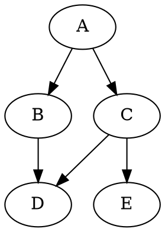
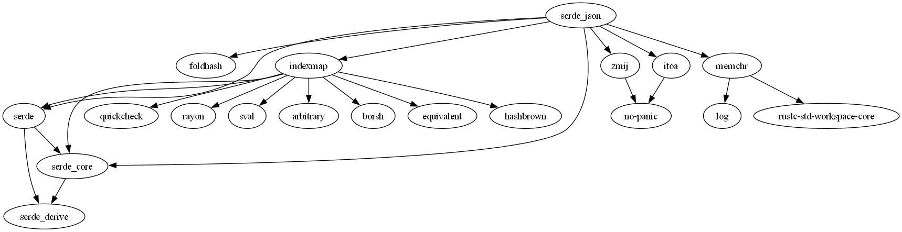
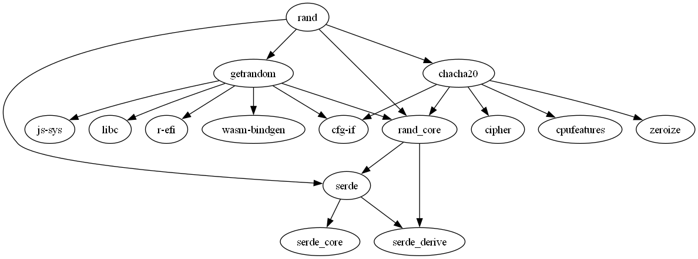
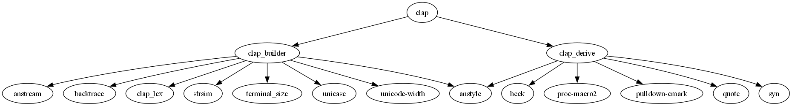

# cargo-dep-visualizer

Инструмент визуализации графа зависимостей пакетов Rust (Cargo), без
использования готовых менеджеров пакетов.

Практическая работа №2 по дисциплине «Конфигурационное управление», вариант 15.

## Этапы

- [x] Этап 1. Минимальный прототип с конфигурацией
- [x] Этап 2. Сбор данных
- [x] Этап 3. Основные операции
- [x] Этап 4. Дополнительные операции
- [x] Этап 5. Визуализация

## Параметры командной строки

| Параметр | Описание | По умолчанию |
|---|---|---|
| `--package <имя>` | Имя анализируемого пакета | обязателен |
| `--repo <url или файл>` | URL репозитория пакетов или путь к файлу тестового репозитория | `https://index.crates.io` |
| `--output <файл.png>` | Имя файла, в который сохраняется изображение графа | `graph.png` |
| `--max-depth <n>` | Максимальная глубина анализа зависимостей, целое число не меньше 1 | `3` |
| `--test-mode` | Режим тестового репозитория: `--repo` указывает на локальный файл с графом, где пакеты обозначены заглавными латинскими буквами | выключен |
| `--ascii-tree` | Дополнительно выводит зависимости в консоль в виде ASCII-дерева | выключен |
| `--reverse` | Вывод обратных зависимостей: пакетов, которые зависят от заданного (только с `--test-mode`) | выключен |

## Обработка ошибок

Программа выводит сообщение об ошибке и завершается с кодом 1, если:

- указан неизвестный параметр (например, `--verbose`)
- после параметра, требующего значения, значение не указано (например, `--package` в конце строки)
- вместо значения указан другой параметр (например, `--package --repo ...`)
- не задано имя пакета или оно пустое
- глубина анализа не является целым числом (например, `--max-depth abc`)
- глубина анализа меньше 1 (например, `--max-depth 0`)
- имя выходного файла не имеет расширения `.png` (например, `--output graph.jpg`)
- папка для выходного файла не существует
- в обычном режиме адрес репозитория не начинается с `http://` или `https://`
- в тестовом режиме (`--test-mode`) файл репозитория не существует
- режим `--reverse` указан без `--test-mode`
- в файле тестового репозитория строка без двоеточия или имя пакета не из заглавных латинских букв
- пакет не найден в репозитории
- произошла ошибка сети или сервер вернул ошибку
- все версии пакета отозваны
- Graphviz не установлен или завершился с ошибкой

## Получение зависимостей

Данные берутся из индекса crates.io (`https://index.crates.io`) напрямую
по HTTP, без использования Cargo и сторонних библиотек.

1. По имени пакета вычисляется путь к его файлу в индексе
   (например, `serde` -> `se/rd/serde`).
2. Файл скачивается; каждая его строка - JSON-описание одной версии пакета.
3. Выбирается последняя версия, не отозванная автором (`"yanked":false`).
4. Из её описания извлекаются зависимости вида `normal`. Зависимости для
   тестов (`dev`) и сборки (`build`) не учитываются, повторы (зависимости
   для разных платформ) выводятся один раз.
5. Для переименованных зависимостей берётся настоящее имя пакета из поля
   `package` (например, `core` -> `rustc-std-workspace-core`).

## Построение графа

Граф строится обходом в глубину (DFS) без рекурсии: используется явный стек,
в котором для каждого пакета хранится его глубина относительно корня.

- **Глубина.** Пакеты на глубине `--max-depth` не раскрываются: они
  попадают в граф только как зависимости.
- **Циклы.** Для каждого пакета запоминается глубина, на которой он был
  раскрыт. Повторно пакет раскрывается, только если до него найден более
  короткий путь, поэтому обход не зацикливается.
- **Источник данных.** Алгоритм не зависит от того, откуда берутся
  зависимости: из crates.io или из тестового файла (интерфейс
  `DependencySource`).

## Обратные зависимости

С флагом `--reverse` программа выводит пакеты, которые зависят от заданного
(напрямую или через другие пакеты). Для этого граф тестового репозитория
разворачивается (каждая стрелка A -> B заменяется на B -> A), и по
развёрнутому графу выполняется тот же обход DFS, что и на этапе 3, с учётом
максимальной глубины и циклов.

Режим доступен только для тестового репозитория: чтобы найти все пакеты
crates.io, зависящие от заданного, пришлось бы загрузить описания всех пакетов
репозитория.

## Визуализация

- **Graphviz.** Граф описывается на языке DOT и сохраняется в файл `.dot`
  рядом с изображением (для `--output graph.png` - `graph.dot`). Затем
  программа вызывает Graphviz (`dot -Tpng`) и получает изображение PNG.
- **ASCII-дерево.** С флагом `--ascii-tree` зависимости дополнительно
  выводятся в консоль деревом. Пакет, который уже был показан выше,
  повторно не раскрывается и помечается `(*)` - так же, как в `cargo tree`.
  Это делает вывод компактным и защищает от зацикливания.

Пример описания на языке DOT (`tests/data/simple.txt`):



## Тестовый репозиторий

Формат файла: одна строка на пакет, имя пакета, двоеточие и его
зависимости через пробел. Пакеты обозначаются заглавными латинскими буквами.

```
A: B C
B: D
D:
```

Готовые тестовые репозитории в `tests/data`:

| Файл | Случай |
|---|---|
| `simple.txt` | обычный граф |
| `cycle.txt` | цикл A -> B -> C -> A |
| `self.txt` | пакет зависит сам от себя |
| `diamond.txt` | до пакета D ведут два пути |
| `deep.txt` | длинная цепочка для проверки глубины |
| `trap.txt` | короткий путь к пакету обнаруживается позже длинного |

## Требования

- JDK 17 или новее
- Graphviz (команда `dot` должна быть доступна в PATH)
- Доступ в интернет (для работы с crates.io)

## Сборка и запуск

```
run.bat --package serde      # cmd
.\run.bat --package serde    # PowerShell
```

Скрипт компилирует исходники из `src` в папку `out` и запускает программу.

## Примеры визуализации

### serde_json

```
> .\run.bat --package serde_json --max-depth 2 --ascii-tree --output docs/serde_json.png
```



```
serde_json
├── foldhash
├── indexmap
│   ├── arbitrary
│   ├── borsh
│   ├── equivalent
│   ├── hashbrown
│   ├── quickcheck
│   ├── rayon
│   ├── serde
│   │   ├── serde_core
│   │   │   └── serde_derive
│   │   └── serde_derive (*)
│   ├── serde_core (*)
│   └── sval
├── itoa
│   └── no-panic
├── memchr
│   ├── rustc-std-workspace-core
│   └── log
├── serde (*)
├── serde_core (*)
└── zmij
    └── no-panic (*)
```

### rand

```
> .\run.bat --package rand --max-depth 2 --ascii-tree --output docs/rand.png
```



```
rand
├── chacha20
│   ├── cfg-if
│   ├── cipher
│   ├── cpufeatures
│   ├── rand_core
│   │   ├── serde
│   │   │   ├── serde_core
│   │   │   └── serde_derive
│   │   └── serde_derive (*)
│   └── zeroize
├── getrandom
│   ├── cfg-if (*)
│   ├── js-sys
│   ├── libc
│   ├── r-efi
│   ├── rand_core (*)
│   └── wasm-bindgen
├── rand_core (*)
└── serde (*)
```

### clap

```
> .\run.bat --package clap --max-depth 2 --ascii-tree --output docs/clap.png
```



```
clap
├── clap_builder
│   ├── anstream
│   ├── anstyle
│   ├── backtrace
│   ├── clap_lex
│   ├── strsim
│   ├── terminal_size
│   ├── unicase
│   └── unicode-width
└── clap_derive
    ├── anstyle (*)
    ├── heck
    ├── proc-macro2
    ├── pulldown-cmark
    ├── quote
    └── syn
```

## Сравнение с cargo tree

Для сравнения использовалась штатная команда Cargo
`cargo tree -p <пакет> --depth 2 -e normal` (Cargo 1.97, Linux) во временном
проекте, в который добавлены пакеты `serde_json`, `rand` и `clap`:

```
serde_json v1.0.154
├── itoa v1.0.19
├── memchr v2.8.3
├── serde_core v1.0.229
└── zmij v1.0.23

rand v0.10.4
├── chacha20 v0.10.2
│   ├── cfg-if v1.0.5
│   ├── cpufeatures v0.3.1
│   └── rand_core v0.10.1
├── getrandom v0.4.3
│   ├── cfg-if v1.0.5
│   ├── libc v0.2.191
│   └── rand_core v0.10.1
└── rand_core v0.10.1

clap v4.6.9
└── clap_builder v4.6.7
    ├── anstream v1.0.0
    ├── anstyle v1.0.14
    ├── clap_lex v1.1.2
    └── strsim v0.11.1
```

**Что совпадает.** Все зависимости, которые показывает `cargo tree`, найдены
и нашим инструментом.

**Почему наш граф больше.** Расхождения объясняются следующими причинами:

1. **Опциональные зависимости.** Часть зависимостей помечена в индексе как
   `optional` и подключается только при включении определённой функции
   пакета (feature). `cargo tree` показывает только зависимости, включённые
   функциями по умолчанию, а наш инструмент - все зависимости вида `normal`.
   Например, `clap_derive` у `clap` подключается только с функцией `derive`,
   а `foldhash`, `indexmap` и `serde` у `serde_json` и `serde` у `rand` -
   опциональные.
2. **Зависимости для разных платформ.** `cargo tree` показывает зависимости
   только для текущей платформы, а наш инструмент - для всех. Например,
   у `getrandom` есть зависимости для WebAssembly (`js-sys`, `wasm-bindgen`)
   и UEFI (`r-efi`), которые `cargo tree` на Linux не показывает. По этой
   же причине вывод `cargo tree` на Windows будет отличаться от приведённого.
3. **Выбор версий.** Cargo подбирает версию каждой зависимости по требованию
   (например, `^1.0`) и может выбрать не самую новую. Наш инструмент для
   каждого пакета берёт последнюю неотозванную версию, поэтому набор
   зависимостей может немного отличаться.
4. **Форма вывода.** `cargo tree` выводит версии и повторяет общую
   зависимость в каждом месте её использования (например, `cfg-if` и
   `rand_core` у `rand`). Наш инструмент показывает каждый пакет в графе
   один раз, а в ASCII-дереве помечает повтор `(*)`.

## Примеры работы с тестовым репозиторием

Обычный граф:

```
> .\run.bat --package A --test-mode --repo tests/data/simple.txt --ascii-tree
Граф зависимостей A (глубина 3):
A -> B, C
C -> D, E
E ->
D ->
B -> D
ASCII-дерево:
A
├── B
│   └── D
└── C
    ├── D (*)
    └── E
Изображение графа сохранено: graph.png
```

Цикл - обход не зацикливается:

```
> .\run.bat --package A --test-mode --repo tests/data/cycle.txt
Граф зависимостей A (глубина 3):
A -> B
B -> C
C -> A
Изображение графа сохранено: graph.png
```

Ограничение глубины:

```
> .\run.bat --package A --test-mode --repo tests/data/deep.txt --max-depth 2
Граф зависимостей A (глубина 2):
A -> B
B -> C
Изображение графа сохранено: graph.png
```

Короткий путь, найденный позже длинного:

```
> .\run.bat --package A --test-mode --repo tests/data/trap.txt
Граф зависимостей A (глубина 3):
A -> X, B
B -> X
X -> Y
Y -> Z
Изображение графа сохранено: graph.png
```

Обратные зависимости:

```
> .\run.bat --package D --test-mode --repo tests/data/simple.txt --reverse
Пакеты, зависящие от D: B, C, A
Обратный граф (пакет -> кто от него зависит):
D -> B, C
C -> A
A ->
B -> A
Изображение графа сохранено: graph.png
```

Обратные зависимости с ограничением глубины:

```
> .\run.bat --package F --test-mode --repo tests/data/deep.txt --max-depth 2 --reverse
Пакеты, зависящие от F: E, D
Обратный граф (пакет -> кто от него зависит):
F -> E
E -> D
Изображение графа сохранено: graph.png
```

Ошибки:

```
> .\run.bat --package takogo-paketa-net-123
Error: Пакет не найден: takogo-paketa-net-123

> .\run.bat --package serde --reverse
Error: Обратные зависимости выводятся только в тестовом режиме

> .\run.bat --package serde --max-depth abc
Error: Глубина должна быть числом: abc
```

## Структура проекта

```
src/
  Main.java              точка входа: разбор параметров, построение и вывод графа
  Config.java            проверенные параметры приложения
  ConfigParser.java      разбор аргументов и проверка всех параметров
  ConfigException.java   исключение для ошибок в параметрах
  CratesIndex.java       загрузка и разбор данных из индекса crates.io
  DependencySource.java  интерфейс источника зависимостей
  CratesSource.java      источник зависимостей: crates.io
  TestSource.java        источник зависимостей: тестовый репозиторий
  TestRepository.java    загрузка тестового репозитория из файла
  GraphBuilder.java      построение графа обходом DFS без рекурсии и разворот графа
  GraphRenderer.java     визуализация: описание DOT, изображение PNG, ASCII-дерево
tests/data/              тестовые репозитории
docs/                    примеры визуализации (PNG и DOT)
run.bat                  скрипт сборки и запуска
```